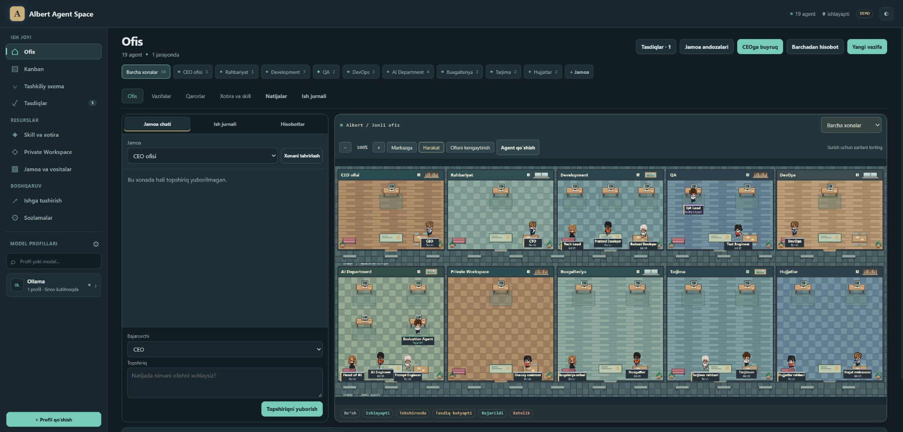
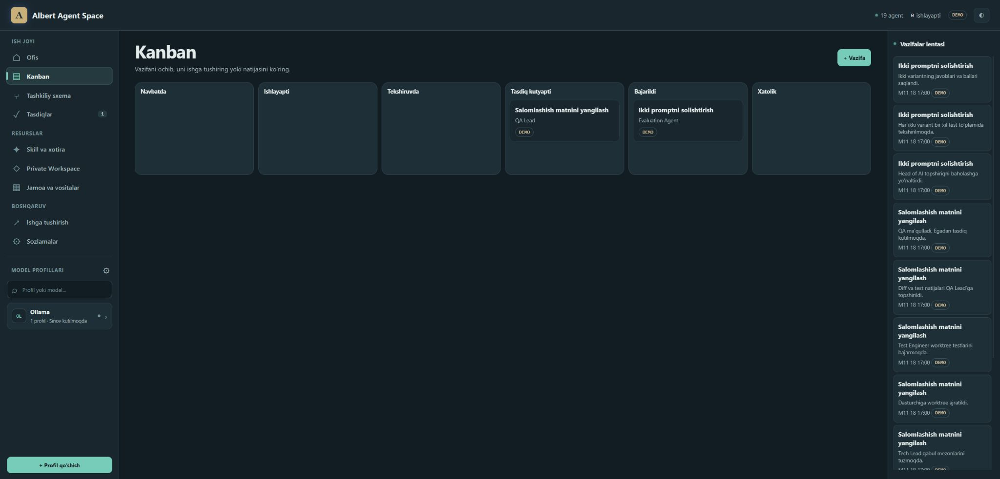
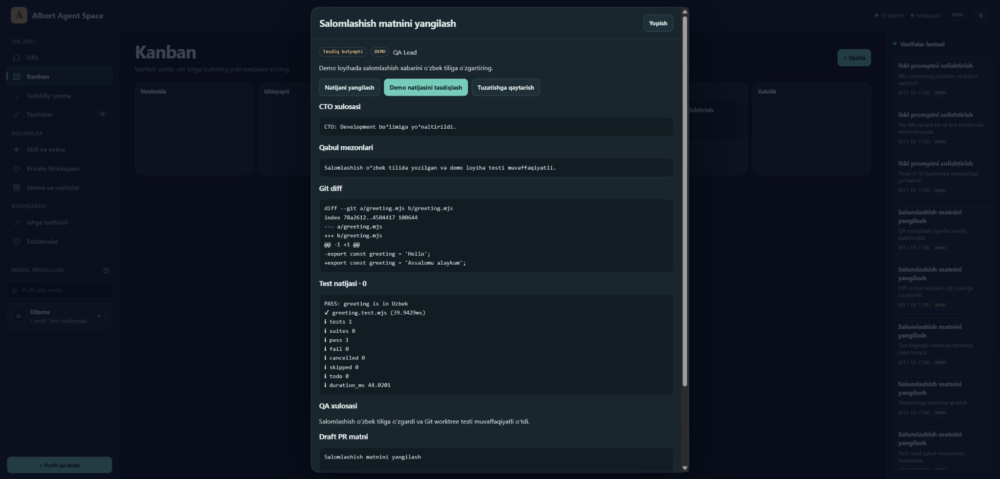
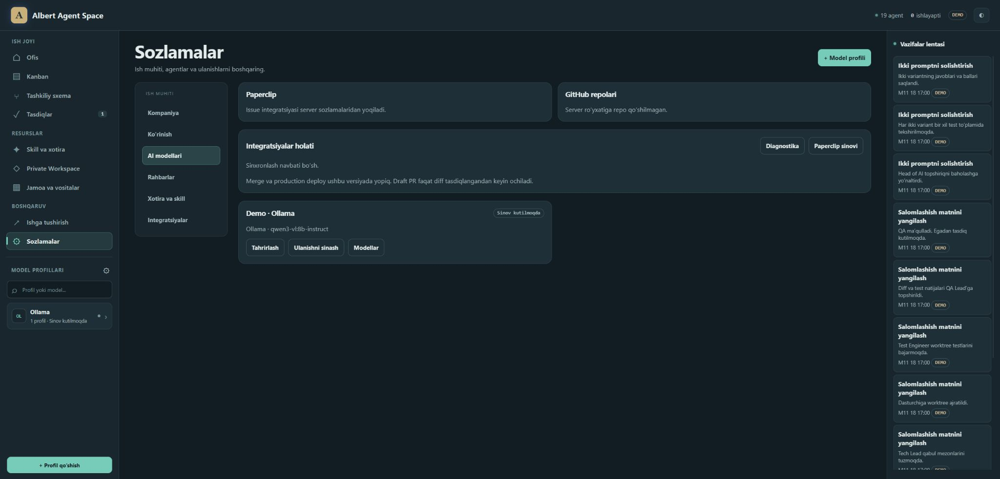
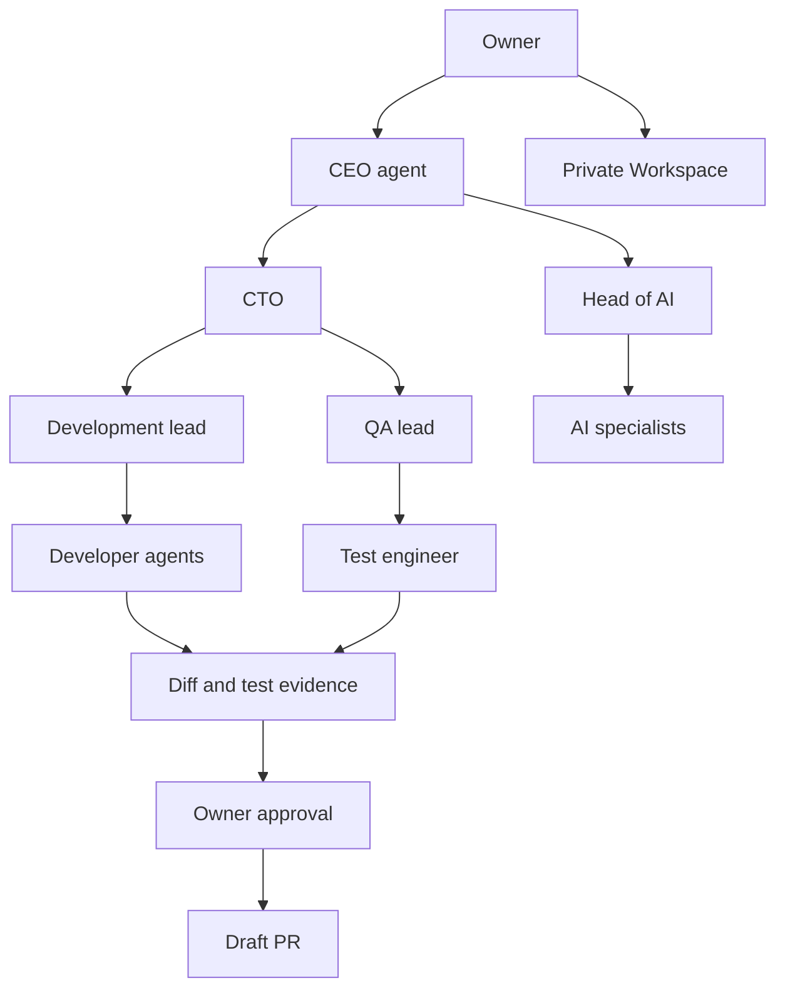

# Albert Agent Space

**A self-hosted visual workspace for AI teams, owner approvals, and persistent knowledge.**

Manage an IT Company, an AI Department, and a private personal workspace from one Uzbek-language web application. Give instructions to a CEO agent, follow the reporting tree, inspect the work, and decide what happens next.

[O‘zbekcha qo‘llanma](README.uz.md) · [Configuration](docs/CONFIGURATION.md) · [Verification](VERIFICATION.md) · [Upstream sources](PROJECTS.md)



> **0.8.0** · Screenshots use an isolated, synthetic demo database. The demo needs no API keys. Live models, external agent services, and GitHub PR creation require configuration. Albert is an independent application inspired by visual agent offices, not the Muratify product.

## Features

| Area | Available behavior |
| --- | --- |
| Visual office | Clickable agents, animated characters, rooms, status labels, meetings, team filters, pan/zoom, and an expanded office view. |
| CEO and team leads | Delegate through direct reports and return results through the same hierarchy; request a company-wide report. |
| IT Company | Task → acceptance criteria → Git worktree → code changes → tests → QA → owner approval → draft PR. |
| AI Department | Compare two prompts/models on the same test cases; retain answers, exact-match scores, and durations. |
| Private Workspace | Upload a document, ask a local model about it, and keep notes, plans, and chat history. |
| Skills and memory | Import/assign skills, retain versions, restore earlier versions, and approve improvement proposals. |
| Model profiles | Named accounts, primary/backup profiles, connection tests, and explicit opt-in for paid fallback. |
| Team templates | Bundled Product, Research, and Content teams; editable managers, roles, rooms, and six character choices. |

The office, Kanban, agent cards, and approval views read the same canonical task records. Meetings illustrate persisted command/report events; movement itself does not execute work.

## Quick start

Requirements: **Node.js 24+** and **Git**. The core app has no npm runtime dependencies to install.

```sh
git clone https://github.com/Albeerte/Albert-Agent-Space.git
cd Albert-Agent-Space
npm run setup
npm test
npm start
```

Open **http://127.0.0.1:8787**. Your generated owner password is in the local `.env` under `OFFICE_PASSWORD`. Setup preserves existing settings. On Windows, you can also double-click **Albert-Start.cmd** after installing Node.js and Git. Keep its terminal open; press **Ctrl+C** there to stop the app.

### Try without API keys

1. Open **Ofis** and choose **IT jarayoni** or **AI taqqoslash**.
2. Open the task from **Kanban** or **Tasdiqlar**.
3. Inspect the diff, test output, and proposed PR text.
4. Approve the demo result or return it with feedback.

The IT demo creates a real local Git worktree, commit, test, and diff. Its draft PR is a **local demo record**, not a GitHub PR. AI demo answers and private demo retrieval are synthetic and labeled **DEMO**.

## Screenshots

### One task state across views



### Review evidence before approval



### Models and settings



## Docker Desktop

Use **Linux containers** mode. Run setup on the host first:

```sh
npm run setup
docker compose up --build -d
docker compose exec ollama ollama pull qwen3-vl:8b-instruct
docker compose logs -f office
```

Open **http://127.0.0.1:8787**. Compose binds the app to localhost, runs it as a non-root user, and stores the database and models in separate named volumes. Stop with `docker compose down`; named volumes remain. Adding `-v` deletes those volumes. Docker/GPU deployment was not exercised in the recorded Windows verification environment.

## Connect a model

In **Sozlamalar → AI modellari**, add a named profile, select its provider/model, and test the connection. Assign it to individual agents or use **Ishga tushirish** to assign a workspace profile.

| Provider | Connection |
| --- | --- |
| Ollama | Local URL, usually `http://127.0.0.1:11434`, and an installed model. |
| LM Studio | Local compatible URL, usually `http://127.0.0.1:1234/v1`. |
| OpenAI API | Platform API key and model ID. |
| OpenRouter | API key and an explicit model ID, `:free` model, or `openrouter/free`. |
| NVIDIA | NVIDIA API key and model ID. |
| Compatible gateway / LiteLLM | Base URL, model ID, and required key. |
| OpenClaw / Codex subscription | Separately configured gateway, remote agent, and official provider login. |

A ChatGPT subscription is separate from OpenAI API billing. Model availability and limits depend on the connected service. Keys are encrypted on the server with AES-256-GCM and never returned to the browser. Retain `OFFICE_MASTER_KEY` with your private backup.

## Organization and approvals



Managers delegate only to direct reports. Results return up the same edges, and failures remain visible in the parent report. Company-wide reports exclude the private assistant. Edit the hierarchy in **Tashkiliy sxema** or **Sozlamalar → Rahbarlar**.

Real GitHub tasks need an explicit repository/file allowlist, scoped token, pipeline models, and a configured Docker test runner. The owner reviews the exact commit's diff/test evidence before a draft PR is created. **Merge and production deployment are not implemented.** The default Compose app does not mount a Docker daemon; real repository tests need the [native-host runner configuration](docs/CONFIGURATION.md#github-tasks).

## Skills, memory, and self-improvement

Use **Skill va xotira** to create/import Markdown skills and assign them to agents. Entries, previous versions, task results, and conversations persist in SQLite. There is no fixed skill-count quota; disk and per-entry limits still apply.

Completed work can propose memory entries or new skill versions. Proposals require owner approval, retain evidence, and reject stale versions. Self-improvement updates instructions and memory; it does not train model weights or automatically execute shell commands from skill text.

Private routes check owner authorization on the server. The corporate agent token cannot read private files, chats, skills, memory, or exports. Private inference defaults to an approved local server and fails visibly if it is unavailable. It has no automatic external fallback. External use needs an explicit document, profile, and question-specific permission.

Supported documents: DOCX, TXT, MD, CSV, JSON, and LOG; up to **2 MB / 160,000 extracted characters**. PDF/OCR ingestion is not implemented.

## Commands

| Command | Purpose |
| --- | --- |
| `npm run setup` | Generate local credentials; preserve existing settings. |
| `npm start` | Start the app. |
| `npm test` | Run behavioral tests with temporary databases and Git repositories. |
| `npm run doctor` | Inspect readiness without printing secrets. |
| `npm run backup` | Write a consistent SQLite snapshot. |
| `npm run preview` | Generate `artifacts/Albert-Agent-Space-Preview.html`, a read-only synthetic preview. |
| `npm run smoke` | Exercise the running app; creates synthetic demo records. |
| `npm run projects -- list` | List pinned upstream projects. |
| `npm run projects -- checkout all` | Download pinned source trees; needs network and substantial disk space. |

## Structure

| Path | Contents |
| --- | --- |
| `public/` | Uzbek UI, Canvas office, reused runtime modules/assets. |
| `src/` | HTTP server, SQLite store, providers, workflows, hierarchy, knowledge, authorization. |
| `migrations/` | Automatically applied database migrations. |
| `scripts/`, `workers/` | Setup, diagnostics, backup, preview, integrations, optional Python workers. |
| `test/` | Behavioral tests and adapter protocol fixtures. |
| `third-party/` | Pins, original samples, templates, and licenses. |
| `docs/` | Configuration and screenshots. |

## Verification and limits

The recorded Windows/Node 24 run passed **29 tests**. Coverage includes Git worktrees, exact approval fingerprints, AI evaluation, private isolation, local-only safeguards, fallback, persistence, hierarchy routing, template idempotency, navigation, and adapter payloads. [VERIFICATION.md](VERIFICATION.md) distinguishes protocol fixtures from live service checks.

Local Ollama and selected Python workers were exercised in earlier verification. Cloud providers, owner GitHub PR creation, all independent upstream servers, and Docker/GPU deployment have not all been tested live. Voice control, embedded agent terminals, browser automation, and visual design annotations are not included.

## Open-source provenance and license

The registry pins **26 projects**. This repo contains **25 selected original source samples**, actual reused visual/navigation modules, and bundled team templates. It does not bundle every upstream application, model weights, or every upstream feature.

See [PROJECTS.md](PROJECTS.md) for commits and adapter status, [SAMPLES.md](third-party/SAMPLES.md) for original samples, and [OFFICE-RUNTIME.md](third-party/OFFICE-RUNTIME.md) for runtime reuse.

Original Albert code is under the MIT terms in [LICENSE](LICENSE). Bundled code/assets retain their original notices. The distributed web app incorporates a **My Virtual Office AGPL-3.0 module**; corresponding application source and its upstream license are included. This is a mixed-license distribution; not every bundled file is MIT.
