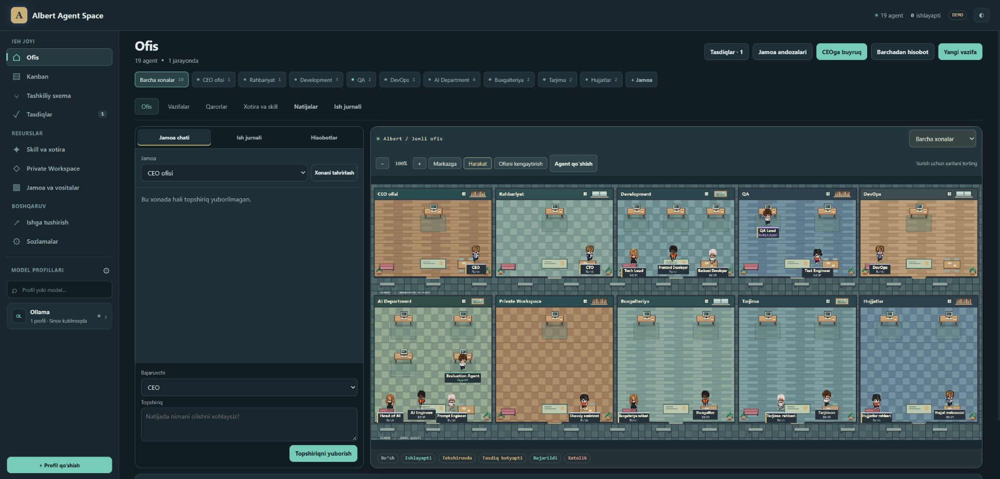
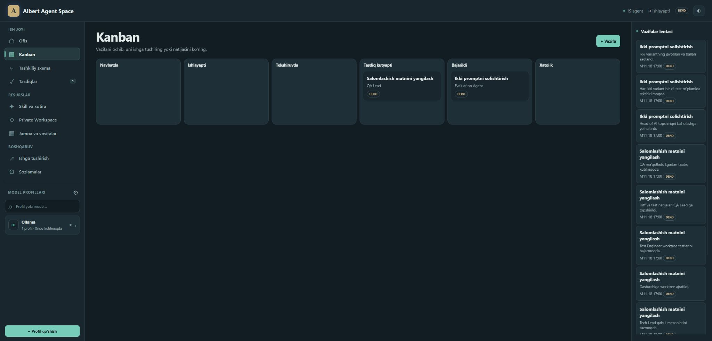
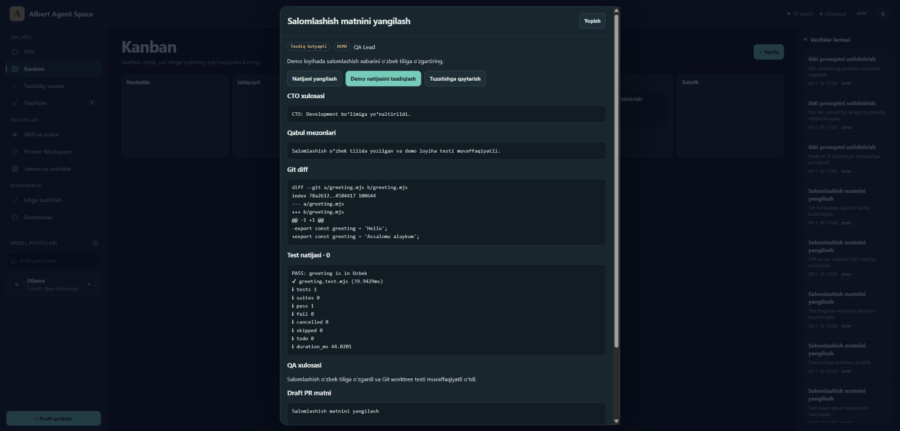
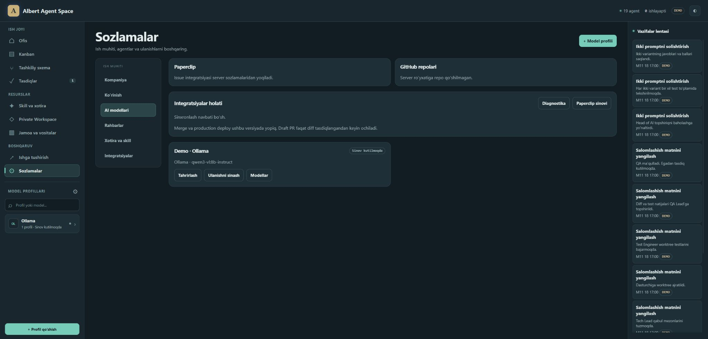

# Albert Agent Space

**Agentlarga topshiriq berish, ishini kuzatish va natijalarni tasdiqlash uchun o‘z serveringizda ishlaydigan vizual ofis.**

[English](README.md) · [Texnik sozlash](docs/CONFIGURATION.md) · [Sinovlar](VERIFICATION.md)



**0.8.0.** Rasmlar alohida sintetik demo bazasida olingan. Albert mustaqil ilova; Muratify mahsulotining o‘zi emas. Haqiqiy model, GitHub va agent xizmatlari alohida sozlanadi.

## Imkoniyatlar

| Bo‘lim | Vazifasi |
| --- | --- |
| Ofis | Xonalar, stollar, agentlar, holatlar, uchrashuvlar, xaritani surish va kattalashtirish. |
| CEO va rahbarlar | Buyruqlarni daraxt bo‘yicha uzatish, xodim natijalarini qaytarish va barchadan hisobot yig‘ish. |
| IT Company | Qabul mezonlari, worktree, kod o‘zgarishi, test, QA, tasdiq va draft PR. |
| AI Department | Ikki model yoki promptni bir xil testlarda solishtirish. |
| Private Workspace | Shaxsiy hujjatlar, suhbatlar, eslatmalar, rejalar va lokal assistent. |
| Skill va xotira | Import, agentga biriktirish, doimiy xotira, versiyalar va tasdiqlanadigan yaxshilashlar. |
| Sozlamalar | Kompaniya, ranglar, model profillari, rahbarlar, xotira va integratsiyalar. |

Ofis, Kanban va tasdiqlar bir bazadan yangilanadi. Yurish va uchrashuvlar serverdagi xabarlarni tasvirlaydi; animatsiyaning o‘zi ish bajarmaydi.

## Windows’da boshlash

Node.js **24+** va Git o‘rnating. PowerShell’da:

```powershell
git clone https://github.com/Albeerte/Albert-Agent-Space.git
cd Albert-Agent-Space
npm run setup
npm test
npm start
```

Manzil: **http://127.0.0.1:8787**. Parol mahalliy `.env` faylidagi `OFFICE_PASSWORD` qiymati. Setup mavjud sozlamalarni almashtirmaydi. Asosiy ilova uchun `npm install` kerak emas.

Muqobil: **Albert-Start.cmd** faylini ikki marta bosing. Terminalni ochiq qoldiring. To‘xtatish uchun **Ctrl+C** bosing. Port band bo‘lsa, `npm start`dan oldin `$env:OFFICE_PORT = '8790'` kiriting.

## Kalitsiz demo

**Ofis → IT jarayoni / AI taqqoslash**ni oching, vazifani Kanban’dan tanlang, natijani ko‘ring va tasdiqlang yoki izoh bilan qaytaring.

IT demo haqiqiy mahalliy worktree, commit, test va diff yaratadi. Demo draft PR GitHub’da ochilmaydi; mahalliy yozuv bo‘ladi. AI javoblari sintetik. Natijalar **DEMO** belgisi bilan ajratilgan.





## Docker Desktop

Linux containers rejimida:

```powershell
npm run setup
docker compose up --build -d
docker compose exec ollama ollama pull qwen3-vl:8b-instruct
docker compose logs -f office
```

`docker compose down` serverlarni to‘xtatadi va named volume’lardagi ma’lumotlarni saqlaydi. `-v` qo‘shilsa volume’lar o‘chadi. Docker/GPU ushbu Windows sinov muhitida jonli tekshirilmagan.

## Model va jamoa

**Sozlamalar → AI modellari → Model profili** orqali nomlangan profil yarating, model/server/kalitni kiriting va **Ulanishni sinash**ni bosing. Profilni agentga yoki **Ishga tushirish** orqali bo‘limga biriktiring.

Ollama, LM Studio, OpenAI API, OpenRouter, NVIDIA, compatible gateway/LiteLLM va OpenClaw/Codex profillari bor. Bitta provayderga bir nechta nomlangan profil qo‘shiladi. Pulli zaxira faqat alohida yoqilganda ishlaydi. ChatGPT obunasi OpenAI API kalitini almashtirmaydi; Codex rasmiy login’i alohida gateway’da sozlanadi.



**CEOga buyruq** topshiriqni rahbarlar orqali uzatadi. Har bir rahbar bevosita xodimlariga vazifa beradi, natija shu yo‘l bilan qaytadi. **Barchadan hisobot** shaxsiy assistentni qamrab olmaydi. **Jamoa andozalari** orqali Mahsulot, Tadqiqot va Kontent rollarini qo‘shing. Xona, rol, boshliq, model va personajni tahrirlash mumkin; tanlov bazada saqlanadi.

Haqiqiy draft PR uchun repo/file allowlist’i, token, agent modellari va Docker test runner kerak. Egasi aynan tayyorlangan commit diff’i va testini tasdiqlaydi. **Merge va production deploy mavjud emas.**

## Xotira va shaxsiy ma’lumotlar

Skill soniga qat’iy kvota yo‘q; disk va yozuv chegaralari amal qiladi. Markdown/TXT import, biriktirish va versiyalar bor. Xotira va tarix avtomatik o‘chirilmaydi. Self-improvement taklifi egasi tasdig‘idan keyin qo‘llanadi; model vaznlarini o‘qitmaydi.

`npm run backup` izchil SQLite nusxasini yaratadi. Bazani tiklashdan oldin serverni to‘xtating; snapshot’ni yangi papkaga `office.sqlite` nomida qo‘yib, `OFFICE_DATA`ni o‘sha joyga yo‘naltiring. Kalitlarni ochish uchun asl `OFFICE_MASTER_KEY` kerak.

Private bo‘lim egasi sessiyasini serverda tekshiradi. Korxona tokeni shaxsiy fayl/chat/skill/xotira/eksportni o‘qiy olmaydi. Standart inference faqat tasdiqlangan lokal modelga ketadi, avtomatik tashqi fallback yo‘q. Tashqi model uchun aniq hujjat, profil va savolga alohida ruxsat kerak.

DOCX, TXT, MD, CSV, JSON, LOG: 2 MB / 160 000 belgigacha. PDF/OCR qo‘shilmagan.

## Tekshiruv va litsenziya

Windows/Node 24’da **29 test** o‘tgan. Git jarayoni, tasdiq izi, private ruxsatlari, lokal rejim, fallback, xotira, iyerarxiya, personajlar, andozalar va adapter protokollari tekshirilgan. Batafsil dalillar va jonli sinovdan o‘tmagan integratsiyalar [VERIFICATION.md](VERIFICATION.md) ichida.

Ovozli boshqaruv, agent terminallari, brauzer avtomatizatsiyasi va vizual dizayn izohlari mavjud emas.

26 loyiha aniq commitlarga biriktirilgan; 25 asl namuna va amalda qayta ishlatilgan modullar kiritilgan. Barcha upstream ilovalar va model og‘irliklari bu repoda emas. Original Albert kodi MIT; kiritilgan manba/grafikalar o‘z shartlarini saqlaydi. Web-ilovada AGPL-3.0 modul bor, uning manbasi va litsenziyasi ham berilgan. [Manbalar](PROJECTS.md) · [Runtime](third-party/OFFICE-RUNTIME.md) · [LICENSE](LICENSE).
